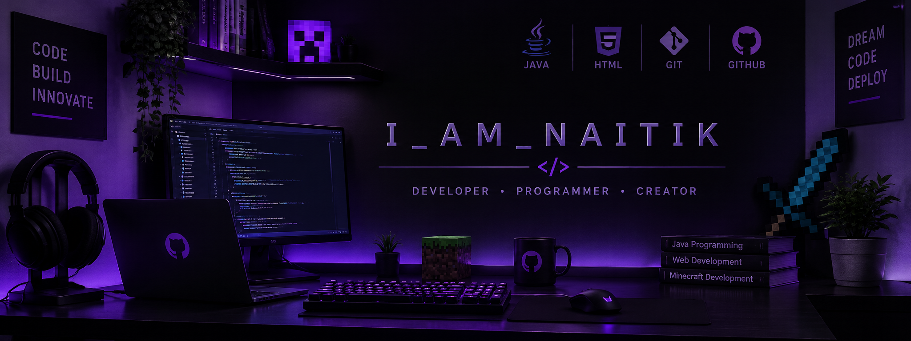

  

 

# `I_am_Naitik`

### Developer • Programmer • Creator

Building digital experiences through code.

---

## About Me

I'm **I_am_Naitik**, a developer interested in building software, exploring technologies, and turning ideas into functional projects.

- 💻 Focused on programming and web development
- ☕ Working with Java
- 🌐 Building with HTML and web technologies
- 🤖 Interested in Discord bot development
- 🎮 Exploring Minecraft development
- 🚀 Constantly learning and improving

---

## Technical Skills

---

## Current Focus

- Developing personal software projects
- Improving Java programming skills
- Exploring modern web development
- Building useful tools and applications
- Learning new technologies

---

## GitHub Analytics

### NAITIK &lt;/&gt;'s Custom GitHub Stats

### Most Used Languages

Custom illustrative stats — not live GitHub account data.

---

### CODE. BUILD. INNOVATE.

*Turning ideas into reality, one line at a time.*

